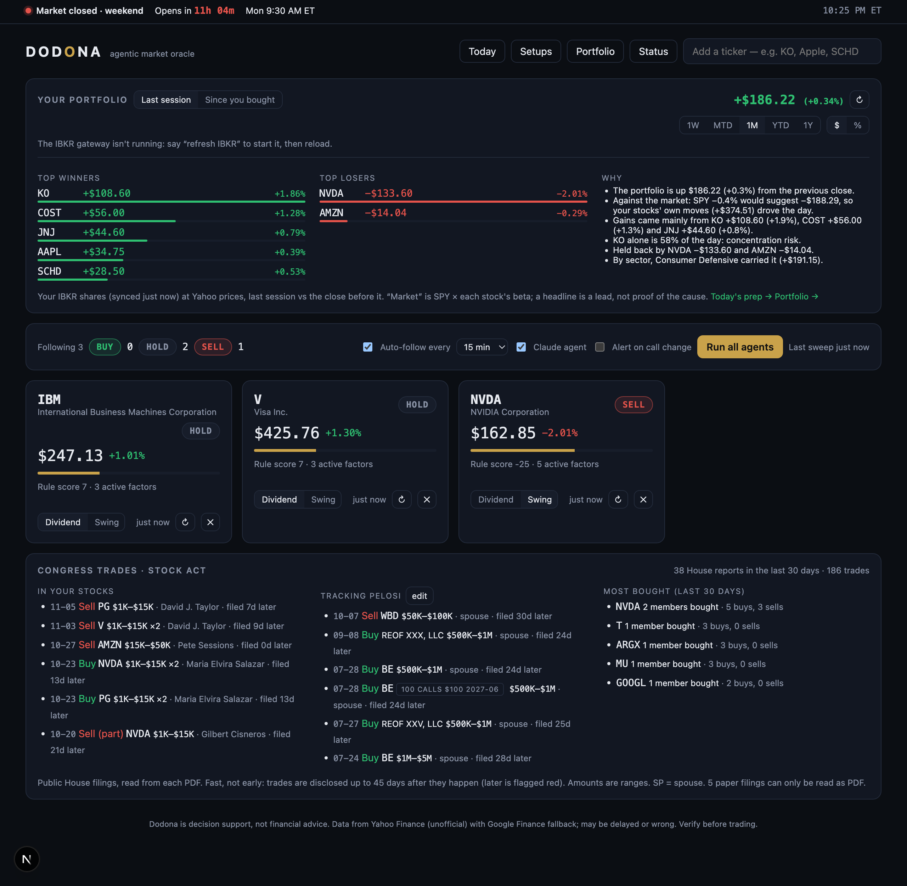
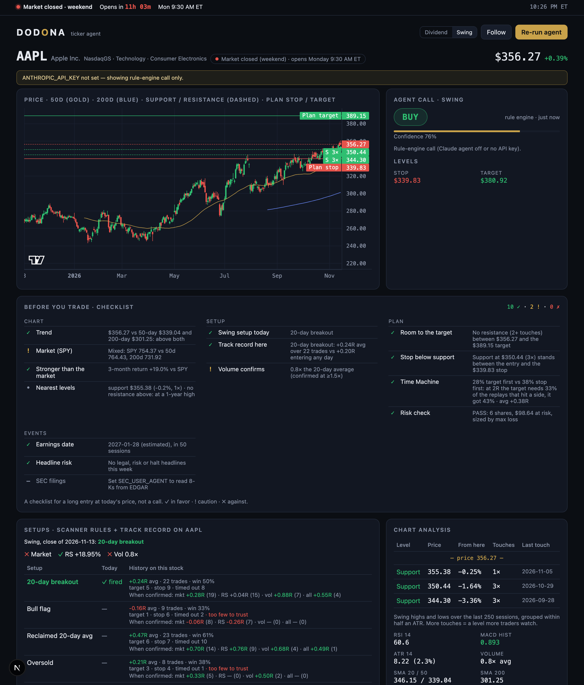
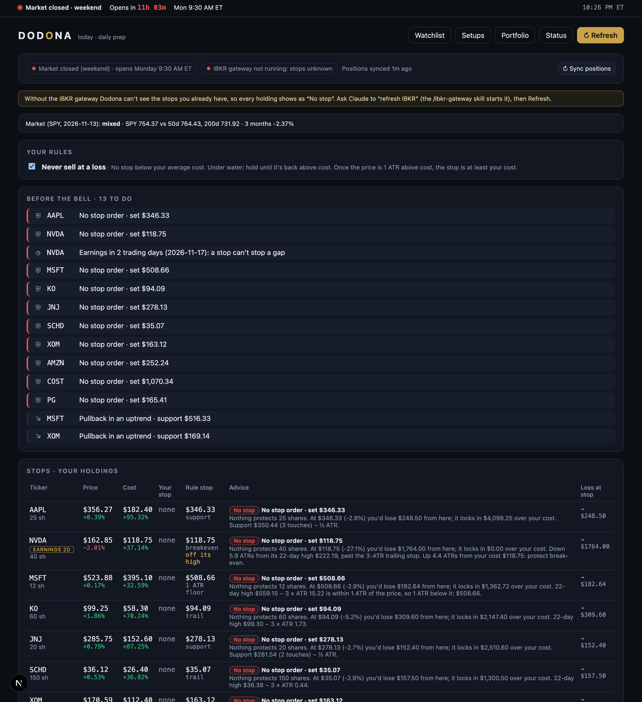
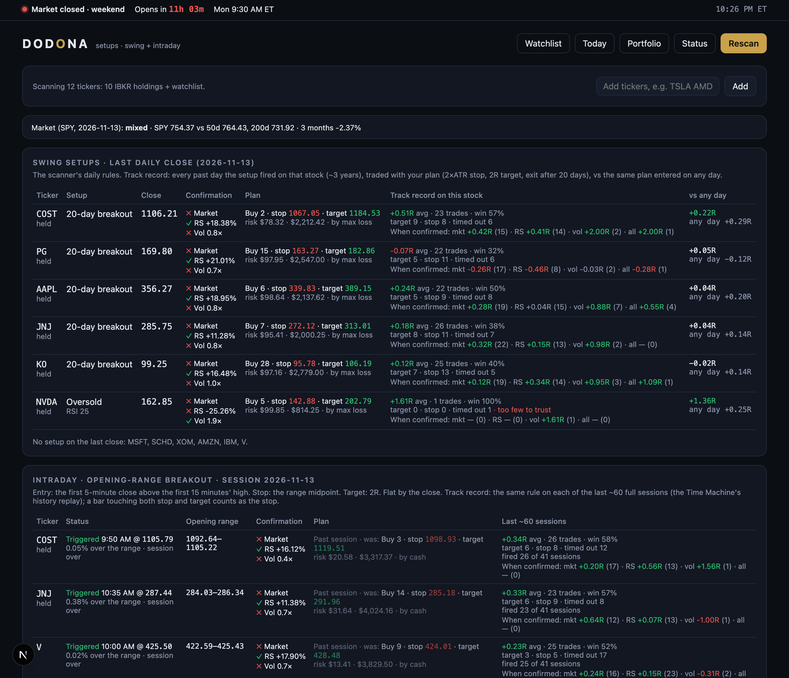
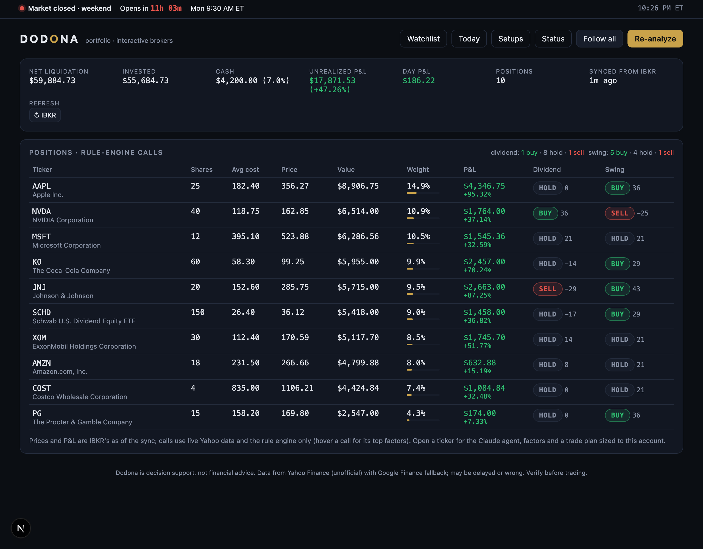
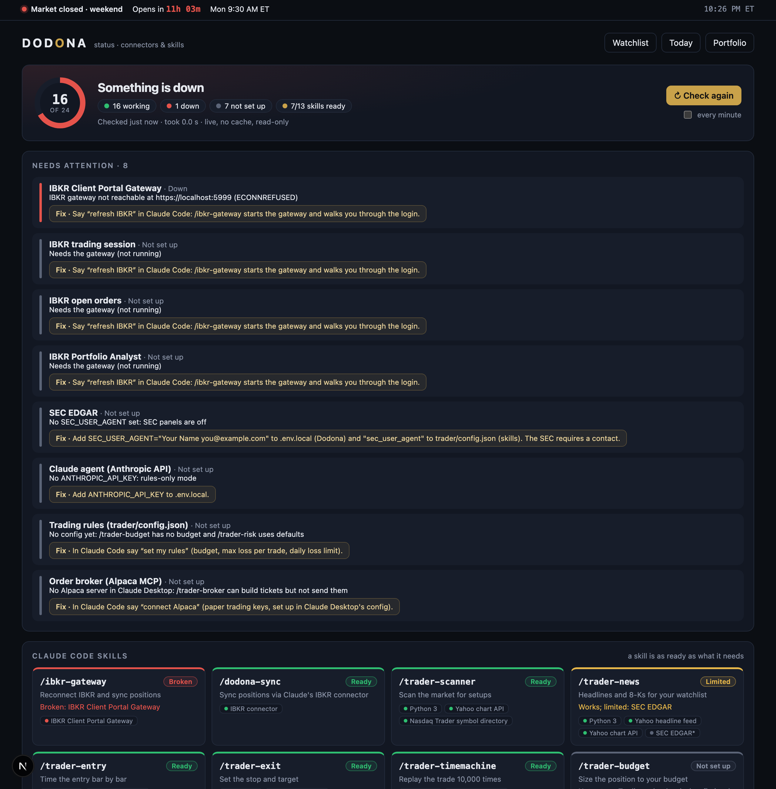

# Dodona

Browser-based investment analytics with a **per-ticker agent** that follows each company and suggests **BUY / SELL / HOLD**, re-evaluating as new data arrives. Click a ticker for everything needed to decide: chart levels, setups and their track record, a trade plan sized to your Interactive Brokers account, Time Machine odds, news, SEC filings and earnings. **Today** prepares the trading day: whether each stop at IBKR should be raised, which holdings have no stop, earnings coming up, and which pullbacks are real discounts. The dashboard opens with your portfolio's top winners and losers and why it's up or down, and tracks Congress members' disclosed trades.

> Decision support, not financial advice. Market data comes from Yahoo Finance (unofficial) with a Google Finance fallback and may be delayed or wrong.

## Screenshots

Captured with a fictional demo portfolio and live market data (`npm run screenshots`); no real account appears.

**Main screen:** market countdown, portfolio winners, losers and why, the watchlist agents and Congress trades.



| | |
|---|---|
| **Ticker page:** chart with levels and the plan, agent call, checklist, setups | **Today:** stops vs the rules, your no-loss rule, the before-the-bell list |
|  |  |
| **Setups:** swing and opening-range breakouts with track records | **Portfolio:** holdings, weights, P&L and rule-engine calls |
|  |  |
| **Status:** every connector and skill, with fixes | |
|  | |

## How it works

```
Browser (watchlist, auto-follow loop, call history and settings in localStorage)
   │  POST /api/analyze {symbol, strategy, previousCall}
   ▼
Next.js API route
   ├─ Data layer ── Yahoo Finance: quote, daily bars, fundamentals, next earnings date, news; SPY for the market
   │                └─ Google Finance page scrape (price-only fallback)
   ├─ Indicators ── SMA 20/50/200, EMA, RSI, MACD, Bollinger, ATR, returns, crosses
   ├─ Levels ────── support / resistance from swing highs and lows
   ├─ Rule engine ─ explainable factors (−2..+2 each) → score −100..100 → BUY ≥ 25, SELL ≤ −25
   │                • dividend: yield vs 5y avg, payout, P/E, growth, leverage, 200d context, analyst target
   │                • swing: trend, crosses, RSI, MACD, Bollinger, momentum, volume, market (SPY), relative strength
   └─ Claude agent ─ reads all of the above + headlines + its previous call,
                     returns action, confidence, thesis, risks, and "what would change the call"

Also loaded by the ticker page:  /api/setups (setups + track records) · /api/research (SEC EDGAR)
Dashboard:                       /api/performance (IBKR account value) · /api/pulse (winners, losers, why) · /api/congress
Portfolio:                       /api/portfolio (trader/portfolio.json) · /api/ibkr (IBKR gateway sync)
Status:                          /api/status (live check of every connector)
Today:                           /api/today (holdings + open IBKR orders + watchlist → stops, discounts, buy limits)
```

- **Following:** every ticker on the dashboard is re-analyzed on an interval (5/15/30/60 min) while the tab is open. When a call flips, the card is highlighted and (optionally) a browser notification fires.
- **Memory:** each ticker's agent gets its last call, so it says what changed instead of starting cold. History is plotted as markers on the chart.
- **No API key?** Dodona still works in rules-only mode.
- **Market bar:** a strip at the top of every page shows whether the NYSE is open and counts down to the next bell ("Opens in 11h 13m"). It shows that time in your own time zone and in ET, and includes holidays and 1:00 PM early closes (`nextBell` in `lib/clock.ts`, `components/MarketBar.tsx`). It turns amber in the last 15 minutes before a bell.

## Run it

```bash
npm install
cp .env.example .env.local      # optional keys: ANTHROPIC_API_KEY, SEC_USER_AGENT, IBKR_* (see the file)
npm run dev                     # http://localhost:3000
```

| Command | What |
|---|---|
| `npm test` · `npm run typecheck` | Tests and type check |
| `npm run ibkr -- status \| sync \| where` | IBKR gateway: is it logged in, sync positions, where it's installed |
| `npm run sync:ibkr` | Turn the IBKR connector's saved output into `trader/portfolio.json` |
| `npm run demo:portfolio` | Write a fictional portfolio at today's prices (`docs/demo/portfolio.json`) |
| `npm run screenshots` | Capture the README screenshots from a running demo server (the `dodona-demo` launch config); it refuses to run against a real portfolio |

Check changes with real market data. `DODONA_MOCK=1 npm run dev` (synthetic data) is only for working offline.

## Layout

| Path | What |
|---|---|
| `lib/data/` | Server-only providers: Yahoo, Google fallback, mock, SEC, House PTRs, IBKR gateway, portfolio file |
| `lib/indicators.ts` | Technical indicators |
| `lib/signals.ts` | Dividend + swing rule engines |
| `lib/plan.ts` | Trade plan for BUY calls: ATR stop, R-multiple target, position size, PASS/BLOCK risk checks |
| `lib/agent.ts` | Claude agent prompt + JSON parsing |
| `lib/analyze.ts` | Orchestrates snapshot → indicators → rules → agent |
| `lib/store.ts` | Browser persistence (watchlist, history, settings) |
| `app/page.tsx` | Watchlist dashboard with auto-follow |
| `app/ticker/[symbol]/page.tsx`, `components/TickerPanels.tsx` | One-stop ticker page: chart with levels, call, checklist, setups, trade plan, Time Machine, news, filings, earnings |
| `lib/portfolio.ts`, `app/portfolio/page.tsx` | IBKR portfolio model and Portfolio page (holdings, weights, P&L, calls per position) |
| `lib/setups.ts`, `lib/backtest.ts`, `app/setups/page.tsx`, `components/SetupBits.tsx` | Swing setups + opening-range breakout (ported from the trader skills) with per-stock track records |
| `lib/market.ts` | Market context (SPY trend), relative strength, volume confirmation |
| `lib/levels.ts`, `lib/timemachine.ts`, `lib/clock.ts`, `lib/news.ts`, `lib/earnings.ts`, `lib/checklist.ts` | Support/resistance, Time Machine, NYSE hours, news/8-K tagging, SEC earnings, the pre-trade checklist (pure) |
| `lib/data/sec.ts`, `app/api/research/route.ts` | SEC EDGAR filings and XBRL facts (server) |
| `lib/congress.ts`, `lib/data/congress.ts`, `components/CongressCard.tsx` | House PTR index + PDF parsing (ported from `/trader-pelosi`) and the dashboard card |
| `lib/data/ibkr.ts`, `app/api/ibkr/route.ts`, `components/IbkrSync.tsx` | Read-only IBKR Client Portal Gateway: positions sync, open orders, and the Refresh button |
| `scripts/ibkr-gateway.ts`, `scripts/sync-ibkr.ts` | `npm run ibkr` (gateway status/sync) and `npm run sync:ibkr` (connector output → `trader/portfolio.json`) |
| `app/api/*` | `analyze`, `quote`, `search`, `setups`, `research`, `congress`, `portfolio`, `ibkr` |
| `lib/prep.ts`, `lib/today.ts`, `app/api/today/route.ts`, `app/today/page.tsx` | Today: suggested stops vs your IBKR stop orders, discounts, resting buy limits, the to-do list |
| `lib/pulse.ts`, `app/api/pulse/route.ts`, `components/PortfolioPulse.tsx` | Main screen: winners, losers and why the portfolio is up or down |
| `lib/performance.ts`, `app/api/performance/route.ts`, `components/AccountChart.tsx` | Main screen: account value chart from IBKR (NAV + time-weighted return) |
| `lib/status.ts`, `lib/data/status.ts`, `app/api/status/route.ts`, `app/status/page.tsx` | Status: live health check of every connector |
| `tests/` | Node test runner suites (`npm test`) |

## Ticker page: everything for one stock

Click any ticker to get the whole picture in one place, with each day-trader skill's work ported in:

| Panel | What | From |
|---|---|---|
| Header | Price, move, NYSE open/closed with holidays and early closes | `/trader-alerts` |
| Chart | Candles, 50/200-day averages, support and resistance (2+ touches), the plan's stop and target, past calls | Dodona |
| Agent call | BUY / SELL / HOLD from the Claude agent or the rule engine; the agent also gets the levels and the next earnings date | Dodona |
| **Checklist** | Every signal as ✓ / ! / ✗ with the reason: trend, market, relative strength, setup today and its track record, volume, room to the target, stop below support, Time Machine odds, risk check, earnings date, big move, headline risk, important 8-Ks | all |
| Setups | The five scanner setups on the last close with this stock's track record, plus today's opening-range breakout | `/trader-scanner`, `/trader-entry` |
| Chart analysis | Support / resistance levels (swing highs and lows grouped within half an ATR) and the technicals | Dodona |
| Trade plan | Stop, target, shares sized to your IBKR account, PASS/BLOCK | `/trader-exit`, `/trader-budget`, `/trader-risk` |
| Time Machine | 10,000 seeded replays of the plan over the next 20 sessions, rebuilt from this stock's last year of daily bars; same stop-first rule and verdict thresholds as the skill | `/trader-timemachine` |
| News & filings | Headlines tagged (earnings, analyst, legal, deal, risk…) and recent SEC filings with 8-K items in plain words | `/trader-news` |
| Earnings | Last 6 quarters from SEC XBRL facts: revenue, margins, net income, EPS, each vs a year earlier, plus TTM and what changed | `/trader-analyst` |

The checklist and Time Machine answer "what if I bought here?" even when the call isn't BUY. SEC panels need `SEC_USER_AGENT` in `.env.local` (SEC requires a name and email). Congress trades live on the dashboard (below). Not ported: `/trader-broker` (Dodona never places orders).

## Setups: swing + intraday

**/setups** scans your IBKR holdings, your watchlist and any tickers you add, using the same rules as the day-trader skills:

- **Swing** (daily bars): `/trader-scanner`'s five setups (20-day breakout, bull flag, reclaimed 20-day average, oversold, oversold bounce) on the last completed close, each with a trade plan sized to your account.
- **Intraday** (5-minute bars): the opening-range breakout (first close above the first 15 minutes' high), stop at the range midpoint, flat by the close.
- **Track record per stock**: every past time the setup fired (~3 years daily, ~60 sessions intraday), traded with the same stop and target, as average R, win rate and target/stop/timed-out counts. Swing setups are compared with the same plan entered on any day, which is what a setup has to beat. Samples under 10 trades are flagged.

- **Confirmation** (`lib/market.ts`): market (SPY above its 50-day average; intraday uses the previous close, so no look-ahead), relative strength (3-month return minus SPY's) and volume (swing: ≥1.5× the 20-day average; intraday: breakout bar ≥1.0× the opening-range bars, `/trader-entry`'s check). Each setup shows today's checks plus "when confirmed": the track record of only the past trades where each check passed, so you can see whether it helps on that stock.
- The swing rule engine scores the market trend and relative strength as factors too, and the Claude agent receives both.

A track record is the past, not a forecast. No commissions or slippage; a gap through a stop can fill worse than −1R.

## Main screen: your portfolio's winners, losers and why

At the top is your **account value chart**, like IBKR's: daily net liquidation value from IBKR's Portfolio Analyst through the gateway, with 1W / MTD / 1M / YTD / 1Y tabs and a $ / % switch. The return is IBKR's time-weighted return, so deposits don't count as gains. Below it, the change in account value is split into investment return (each day's return × the previous day's value) and net deposits. IBKR updates it once a day; it needs the gateway logged in.

Below the chart are your IBKR holdings at live Yahoo prices: the top 5 winners and losers in dollars, for the last session or since you bought. Next to them is a plain-language reading of why (`lib/pulse.ts`), all arithmetic:

- **Market vs your stocks:** SPY's move × each holding's beta is what the market alone explains; the rest is your stocks' own moves ("mostly the market", "partly", or "against the market").
- **Drivers:** the 3 biggest contributors and their share of the move, what held it back, and the sector that carried it.
- **Concentration:** when one position is half the move, or more than all of it ("without IBM you'd be +$280").
- **Big movers:** any holding that moved 3%+, with its latest headline (a lead, not proof of the cause).
- **Since you bought:** total P&L on what you invested, the positions carrying and dragging it, and how many are above cost.

## Today: prepare the trading day

**/today** reads your synced holdings, the orders resting at IBKR (through the gateway, read-only) and your watchlist, and lists what to do before the bell:

- **Stops.** For each holding, a rule stop: the highest of the 22-day high − 3 × ATR (2 × when the stock is stretched: RSI ≥ 75 or 3+ ATRs above its 20-day average), ½ ATR under the nearest support with 2+ touches, and your average cost once you're 3 ATRs up. It's never within 1 ATR of the price. A stock already more than 3 ATRs off its high has crossed its trail, so support (or 2 ATRs) is used. It's compared with your actual stop order: **Raise** (by at least ¼ ATR), **Keep**, **Tight** (within ½ ATR, likely shaken out), **No stop**, **Partial** (covers fewer shares than you hold). Stops only ever move up. Each row shows the loss at the stop now and after the change.
- **Your rules** (saved in this browser, on by default). **Never sell at a loss:** no stop goes under your average cost. A position under water shows **Hold to break-even** with the % it needs to get back. A position less than 1 ATR above cost also holds, because a stop at cost would be hit by noise. Once the price is 1 ATR above cost, the stop is at least your cost (rounded up to the cent), and a stop under cost at IBKR is flagged **Under cost**. Add plans note that, under this rule, their stop sizes the add rather than being placed. More rules go in the same panel (`TradingRules` in `lib/prep.ts`).
- **Earnings** within 7 trading days for what you hold or have limits on: a stop can't protect against a gap.
- **Discounts.** Uptrend (above the 200-day, 50-day above it) plus 2 of: within 1 ATR of a strong support, RSI ≤ 40 or back at the 50-day, an oversold bounce or a reclaimed 20-day average. In a downtrend a lower price is **Falling**, not a discount. Discounts and "watch" names get an add plan (shares, stop under the support, max loss) from your Trade plan settings and the real account.
- **Buy limits.** Each resting BUY limit: how far the price must fall (in % and ATRs), whether it sits on a support, a support above it that may hold first, or a downtrend.

Without the gateway logged in, Dodona can't see your stops (say "refresh IBKR"). Dodona never places, moves or cancels an order: make the change in IBKR.

## Status: are the connectors working?

**/status** (linked from every page) checks each connector live, bypassing the caches, and shows whether it's working, how long it took, which features need it, and how to fix it:

- **Broker:** the IBKR gateway (running, logged in, account masked), the trading session (connected, or competing with another IBKR login), open orders, Portfolio Analyst, and how old the synced portfolio file is.
- **Market data:** Yahoo quotes, daily bars, 5-minute bars, fundamentals and news, plus the Google Finance price fallback.
- **Research:** SEC EDGAR (needs `SEC_USER_AGENT`) and the House Clerk's disclosure index.
- **AI:** the Anthropic API key and model, validated by listing models, which costs nothing.
- **Skills:** everything the Claude Code skills reach: Python 3, Yahoo's chart API and headline feed (direct, with the skills' User-Agent), Nasdaq Trader's symbol lists, Yahoo's backup host (query1), `pdftotext`, `trader/config.json`, the Alpaca MCP server in Claude Desktop (server name and paper flag only, never keys), and when `/dodona-sync` last used the IBKR connector. Stooq isn't checked: it shut down its free CSV quotes, and `/trader-alerts` only used it with `--source stooq` (Yahoo is the default).
- **Local:** NYSE holiday calendar coverage and the synced portfolio file.

The top of the page shows an overall health ring, a **Needs attention** list with the fix for each item, and a **Claude Code skills** grid. Each skill is Ready, Limited (an optional dependency is missing), Not set up or Broken, from what it depends on (`SKILL_DEPS` in `lib/status.ts`; a test fails if a skill folder has no entry). "Not set up" means optional and not configured. Every check only reads; turn on "every minute" to keep the page live.

## Congress trades (dashboard)

The dashboard's **Congress trades** card reads the House Clerk's public STOCK Act reports the way `/trader-pelosi` does: the yearly index, then each Periodic Transaction Report PDF (read with pdf.js, cached once per report in `trader/state/congress/`). It shows trades in your holdings and watchlist, the members you track (Pelosi by default, editable), and the tickers the most members bought in the last 30 days. Amounts are ranges, owners matter (SP = spouse), and every row links to its PDF with how many days it took to disclose (over 45 is flagged). Fast, not early: these trades are days to weeks old. House only; paper filings with no text layer are counted, not parsed.

## Portfolio (Interactive Brokers)

Two ways to load your positions, both read-only (Dodona never places orders):

**From Dodona: the "Refresh from IBKR" button** (Portfolio page, and on stale trade plans) reads IBKR's Client Portal Gateway, IBKR's own small Java app that serves its Web API on this machine:

1. Install Java (`brew install --cask temurin`), download the Client Portal Gateway from IBKR's Web API page and unzip it.
2. In `root/conf.yaml` set `listenPort: 5001` (macOS AirPlay Receiver already uses 5000).
3. Start it with `bin/run.sh root/conf.yaml`, open https://localhost:5001 and log in (once a day).
4. Press **Refresh from IBKR**, or in a Claude Code session say **"refresh IBKR"**: the `/ibkr-gateway` skill checks the gateway, starts it if needed, sends you to log in, then runs `npm run ibkr -- sync`. Dodona reads accounts, positions and the summary and writes `trader/portfolio.json`. Set `IBKR_GATEWAY_URL` / `IBKR_ACCOUNT` in `.env.local` to change the port or pick an account; only localhost URLs are accepted.

**Through Claude: the IBKR connector:**

1. In a Claude Code session in this repo, say **"sync my IBKR positions"**. The `/dodona-sync` skill calls the connector's `get_account_positions` and `get_account_summary`, saves them under `trader/ibkr/`, and runs `npm run sync:ibkr`.
2. That writes `trader/portfolio.json` (gitignored, stays on this machine). It's a superset of the day-trader skills' format, so `/trader-budget`, `/trader-news` and `/trader-alerts` see the same holdings.
3. Open **/portfolio**: net liquidation, cash, P&L, a concentration warning above 20% of the account, and the dividend and swing rule-engine calls for every holding. Ticker pages show what you hold, and trade plans size to your real net liquidation and cash, counting what you already own toward the position cap.

Positions update only when you sync (button, "refresh IBKR", or the connector); the page flags a sync older than a day. The gateway's positions don't include day P&L, so it reads $0 after a gateway sync.

## Day-trader skills (Claude Code)

`.claude/skills/trader-*` vendors the 11 skills from [day-trader-skill](https://github.com/Jakeschincariol/day-trader-skill) (MIT, see `.claude/skills/LICENSE-day-trader-skill`). In a Claude Code session in this repo, run them as slash commands:

```
/trader-scanner → /trader-news → /trader-entry → /trader-exit → /trader-timemachine → /trader-budget → /trader-risk → /trader-broker
/trader-alerts · /trader-analyst · /trader-pelosi
```

- Standard-library Python 3.8+, nothing to install. `/trader-pelosi` uses `pdftotext` (poppler) if present.
- They read and write a `trader/` folder at the repo root (gitignored): `config.json`, `plan.json`, `orders.json`, the broker log.
- SEC tools need `"sec_user_agent": "Your Name you@example.com"` in `trader/config.json` or the `SEC_USER_AGENT` env var.
- Nothing places an order on its own; `/trader-broker` is paper by default and requires your explicit yes per order.
- The skills are independent of the Next.js app; Dodona's UI does not call them. Dodona ports their logic to TypeScript instead (see the "From" column above).

Dodona's own skills, in the same folder:

- `/ibkr-gateway`: "refresh IBKR" / "reconnect IBKR". Checks the gateway, starts it, sends you to log in, syncs.
- `/dodona-sync`: "sync my IBKR positions" through Claude's IBKR connector.

## Roadmap ideas

- Server-side scheduler (Cloud Run job / cron) so agents follow tickers even with the browser closed, plus a DB (Postgres/Firestore) for shared history
- Market-wide scan (~5,900 symbols) on the Setups page, like `/trader-scanner daily`
- Earnings-calendar and ex-dividend alerts; SEC filings and reported quarters in the agent context
- Congress trades for one stock on its ticker page; Senate reports
- Orders through the IBKR gateway (e.g. "raise this stop" from Today), each one shown as a ticket and placed only on your explicit yes
- Paper-trading ledger to grade the agents' and setups' live calls over time
